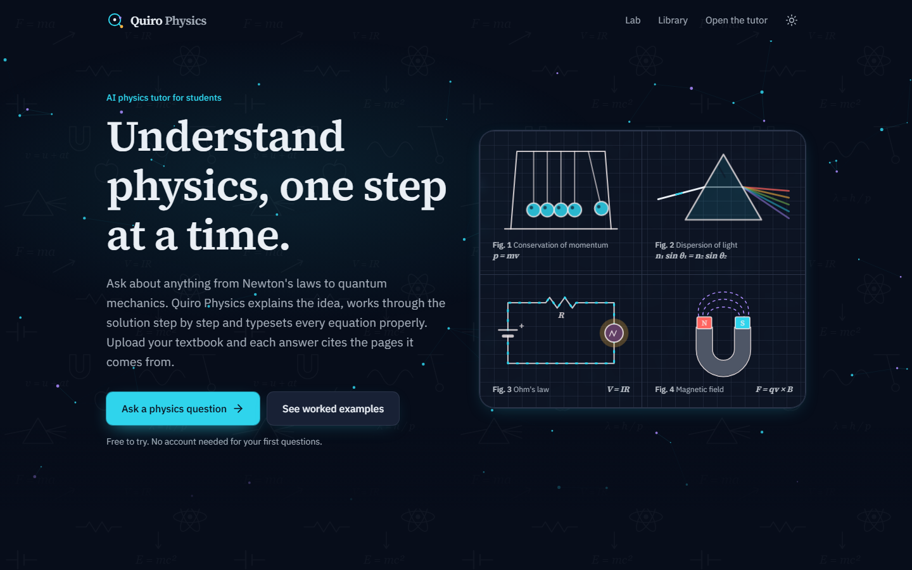
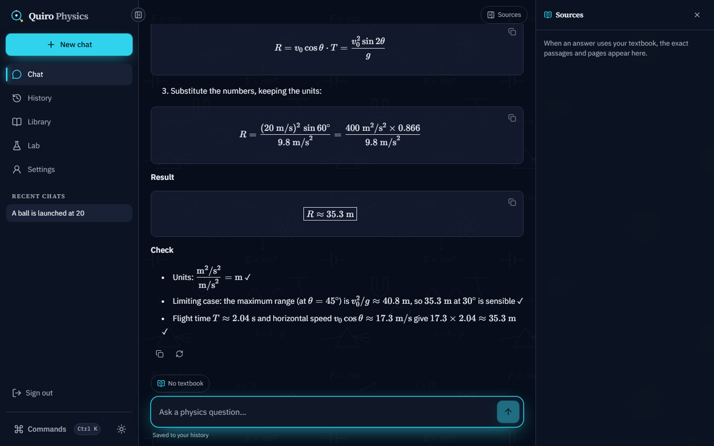
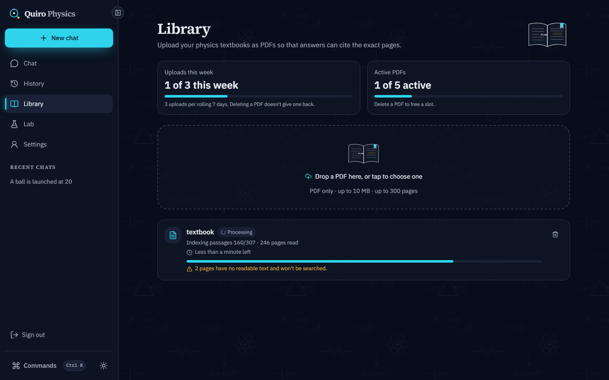
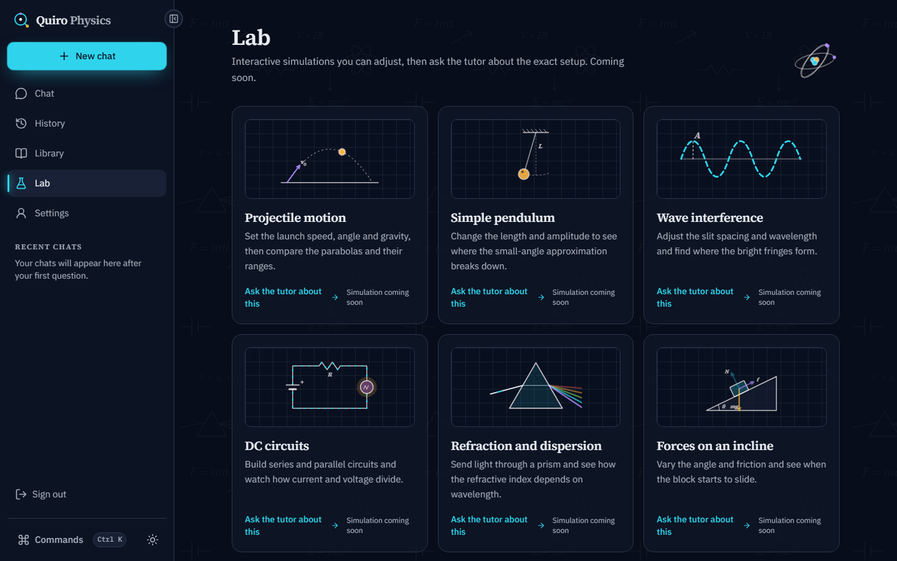
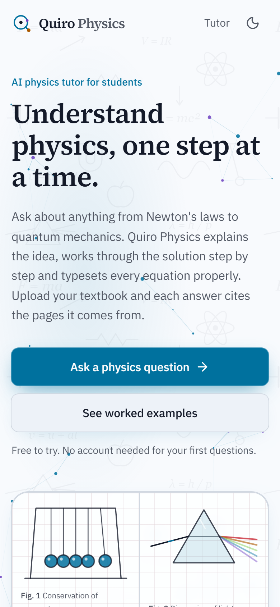

<div align="center">


# Quiro Physics

**Understand physics, one step at a time.**

An AI physics tutor that explains the idea, works through the maths step by step, typesets every equation, and cites the exact pages of your own textbook.

[**Live demo: quirophysics.vercel.app**](https://quirophysics.vercel.app)

[](https://nextjs.org)
[](https://react.dev)
[](https://www.typescriptlang.org)
[](https://tailwindcss.com)
[](LICENSE)

</div>

<p align="center">
  
</p>

## Table of contents
- [Features](#features)
- [Screenshots](#screenshots)
- [Tech stack](#tech-stack)
- [Run it locally](#run-it-locally)
- [Project structure](#project-structure)
- [License](#license)

## Features
- **Step-by-step solutions.** Every worked problem follows Given, Find, Concepts, Equations, Solution, Result and Check, with SI units on every quantity.
- **Beautiful maths.** Equations stream in token by token and render with KaTeX, including fractions, vectors, aligned steps and boxed results.
- **Answers from your textbook.** Upload a PDF and the tutor cites the pages it used, with the exact passages in a Sources panel.
- **Physics-aware PDF parsing.** Keeps equations with their variable definitions and worked examples with their solutions; reads superscripts and subscripts correctly.
- **Hybrid retrieval.** pgvector similarity search and Postgres full-text search, fused with reciprocal rank fusion.
- **Live processing progress.** The library updates without a refresh, with passages indexed, pages read and time remaining.
- **Layered memory.** Recent turns, a rolling summary and structured physics facts (the active problem, symbols and the learner's level).
- **Guest mode.** Ask questions without an account; sign in to keep going and save every chat to your history.
- **Model fallback chain.** If a model is down or rate limited, the next one answers.


## Screenshots

<table>
  <tr>
    <td width="50%"></td>
    <td width="50%"></td>
  </tr>
  <tr>
    <td align="center"><b>Step-by-step answer</b> with typeset equations and a units check</td>
    <td align="center"><b>Textbook library</b> with live processing progress</td>
  </tr>
  <tr>
    <td width="50%"></td>
    <td width="50%" align="center"></td>
  </tr>
  <tr>
    <td align="center"><b>Physics lab</b></td>
    <td align="center"><b>Mobile</b>, Lab Light theme</td>
  </tr>
</table>

## Tech stack

| Area | Technology |
| --- | --- |
| Framework |    App Router, server components, route handlers |
| UI |    shadcn/ui patterns, Lucide icons, cmdk, Vaul, Sonner |
| Maths |  Streamdown, remark-math, rehype-katex |
| AI streaming |   |
| LLMs |  GPT-OSS 120B / 20B, Llama 3.3 70B, Llama 3.1 8B (configurable chain) |
| Embeddings |  `gemini-embedding-001`, 768 dimensions |
| Auth |  |
| Database |    PGlite for local development |
| Storage and cache |   |
| PDF | unpdf (text, layout, superscripts and subscripts) |
| Validation |  typed environment with `@t3-oss/env-nextjs` |
| Hosting |  Hobby tier, daily cron |
| Tooling |   ESLint, Prettier |


## Run it locally

### Prerequisites
- [Node.js](https://nodejs.org) 22 or newer
- [pnpm](https://pnpm.io) 11 (`corepack enable` sets it up)

### Quick start (no keys needed)

```bash
git clone https://github.com/Aman554-EQ/Quiro-Physics.git
cd Quiro-Physics
pnpm install
cp .env.example .env.local
pnpm dev
```

Open [http://localhost:3000](http://localhost:3000). With an empty `.env.local` the app runs in guest mode with a built-in demo tutor, an in-memory KV store and a local PGlite database in `.data/pglite`, so you can explore the whole UI offline.

### Full setup (real tutor, accounts and textbooks)
1. Create free accounts and copy the keys into `.env.local` (see [Environment variables](#environment-variables)):
   [Groq](https://console.groq.com), [Google AI Studio](https://aistudio.google.com), [Clerk](https://dashboard.clerk.com), [Neon](https://neon.tech), [Upstash](https://console.upstash.com).
2. Apply the database migrations to Neon once (this also enables pgvector):
   ```bash
   pnpm db:migrate
   ```
3. Check that every configured model answers:
   ```bash
   pnpm smoke:models
   ```
4. Start the app with `pnpm dev`.

### Commands

| Command | What it does |
| --- | --- |
| `pnpm dev` | Development server on port 3000 |
| `pnpm build` | Production build |
| `pnpm start` | Serve the production build |
| `pnpm lint` | ESLint |
| `pnpm typecheck` | Route types and TypeScript |
| `pnpm format` | Prettier |
| `pnpm db:generate` | Generate a migration from the Drizzle schema |
| `pnpm db:migrate` | Apply migrations to `DATABASE_URL` |
| `pnpm db:studio` | Browse the database in Drizzle Studio |
| `pnpm smoke:models` | Call every model in the chain and print time to first token |


## Project structure

```
src/
├── app/
│   ├── (marketing)/     Landing, privacy and terms pages
│   ├── (app)/           Chat, history, library, lab and settings
│   └── api/             Chat stream, documents, limits, newsletter, webhooks, cron
├── components/          UI: chat, library, landing, shell, physics visuals
├── server/
│   ├── chat/            Orchestrator, router chain and prompts
│   ├── rag/             PDF parsing, chunking, embeddings, retrieval, ingestion jobs
│   ├── models/          Groq model registry and fallback chain
│   ├── memory/          Rolling summary and physics facts
│   ├── limits/          Guest and user quotas
│   ├── db/              Drizzle schema and queries
│   └── storage/, kv/    Vercel Blob and Upstash clients
├── shared/              Code shared by client and server (LaTeX normalisation, types)
└── config/              Typed environment schema
drizzle/                 SQL migrations
```

## Known limitations
- Groq's free tier allows only a few answers at the same time; the model chain spreads the load.
- Scanned PDFs without a text layer can't be searched (OCR is off by default).
- Uploaded PDFs are deleted after indexing by default (`RETAIN_PDF=false`) to stay within free Blob storage.
- AI answers can contain mistakes. Check important results against your course material.

## License

Released under the [MIT License](LICENSE). © 2026 [Aman554-EQ](https://github.com/Aman554-EQ).